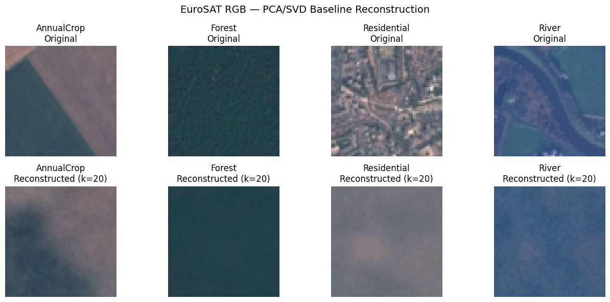

# Rank-Based Reconstruction Analysis of EuroSAT Satellite Images Using SVD

**Course:** Mathematical and Statistical Foundations for Data Science & Computational Intelligence (Fall 2026)  
**Track:** Standard — Track 1 (PCA/SVD)  
**Team:** Haider Rasool Qadri (24I-8023), Muhammad Saad (24I-8035) — MS(DS)

## Research question

How does the number of retained SVD components (k) affect reconstruction error on EuroSAT RGB images, and does this effect differ across land-use categories?

## Project status

**Feasibility baseline completed; full experiments are not yet completed.** This repository includes the original executed Kaggle notebook, its stored baseline results, and an exported reconstruction figure.

## Dataset

[EuroSAT RGB](https://github.com/phelber/EuroSAT) satellite imagery, 64×64 RGB pixels, from Sentinel-2. The initial feasibility experiment samples 200 images each from AnnualCrop, Forest, Residential, and River (800 total). The dataset is not included in this repository; see [data setup](data/README.md).

## Baseline procedure

1. Sample 200 images per class with random seed 42.
2. Normalize to [0, 1] and flatten each image into 12,288 features.
3. Stratified 80/20 split: 640 train / 160 test.
4. Fit training-only PCA (`sklearn.decomposition.PCA`, randomized SVD, rank 20, seed 42).
5. Reconstruct test images and compute MSE, mean relative reconstruction error, and cumulative **training** explained variance.

## Saved baseline results

| Metric | Saved output |
|---|---:|
| Rank k | 20 |
| Training / testing images | 640 / 160 |
| Reconstruction MSE | 0.003889 |
| Mean relative error | 0.132051 |
| Cumulative training explained variance | 84.95% |
| Recorded runtime | 1.54 seconds |

Execution time is for the recorded Kaggle run, not a benchmark of other hardware. These values are results of the 800-image feasibility subset, not the planned 9,000-image experiment.

## Repository layout

- `notebooks/eurosat-svd-feasibility-checkpoint.ipynb` — original executed notebook.
- `results/baseline_results.csv` — saved numerical output transcribed from the notebook's stored result table.
- `results/baseline_reconstruction.png` — figure extracted from the notebook's saved display output.
- `data/README.md` — obtain EuroSAT and set up paths.
- `docs/feasibility-checkpoint-note.md` — short submission note (replace repository URL).
- `requirements.txt` — Python dependencies.

## How to reproduce

**Kaggle (as originally run):** Add `apollo2506/eurosat-dataset` to a Kaggle notebook and run `notebooks/eurosat-svd-feasibility-checkpoint.ipynb` from top to bottom. The notebook uses the Kaggle input/output paths and saved dependency versions include NumPy 2.1.3 and scikit-learn 1.6.1.

**Laptop:** Install Python packages using `pip install -r requirements.txt`, download EuroSAT RGB, set `DATASET_PATH` to the local RGB folder, and replace `/kaggle/working/` in the two output paths with `results/` before running the notebook. These path edits are required for a local run; the original notebook has not been modified.

## Planned work

Increase the balanced sample toward the proposed 9,000 images (2,250 per class), compare ranks `5, 10, 20, 40, 80, 120`, analyze class-wise test reconstruction error and training explained variance, and repeat across fixed seeds if compute permits. The feasibility of the full experimental plan is still to be checked.

## Data and code attribution

EuroSAT: Helber et al., *EuroSAT: A Novel Dataset and Deep Learning Benchmark for Land Use and Land Cover Classification*, IEEE J-STARS (2019). Dataset terms and attribution: see the official EuroSAT repository.
